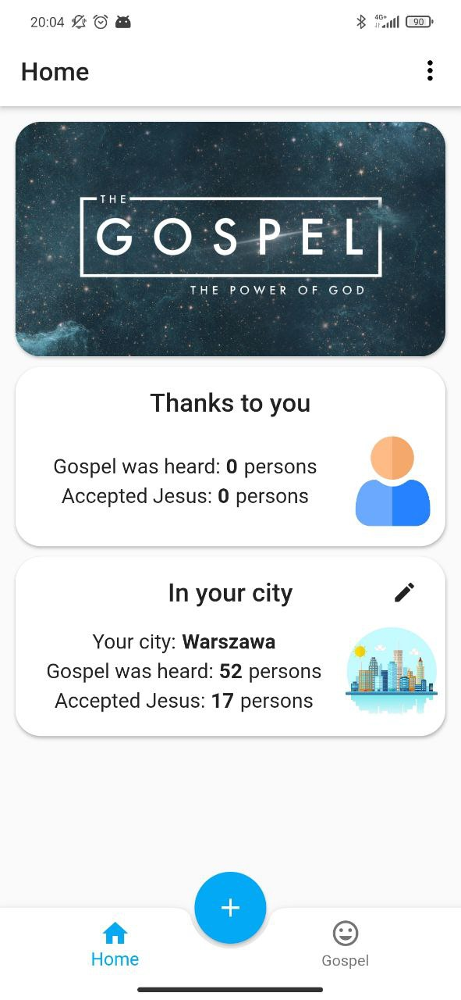
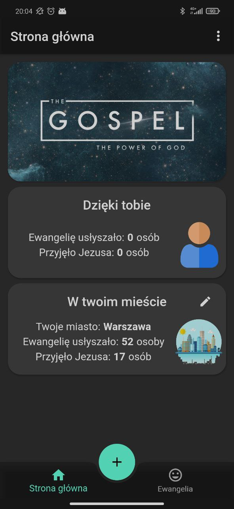
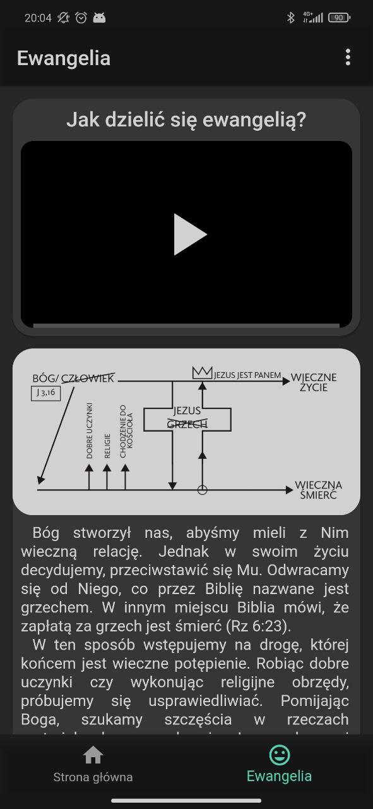

# ShareGospel

> **Archived.** An unfinished learning project from 2020–2023, moved here from GitLab. It isn't
> maintained, and its Firebase configuration has been removed.

**Keep count of the Gospel you share.** A small Flutter app to log each time you share the
Gospel with someone, and whether they accepted Jesus, then see what it adds up to: for you, and
for your whole city. Written to learn Flutter and Firebase.

<p>
  
  
  
</p>

## What it does

- **Add a share** with the + button: one more person who heard the Gospel, and whether they
  accepted Jesus.
- **Your statistics**, kept on the device, and **your city's**, added up by everyone in it
  (Cloud Firestore); pick your city, or add it.
- **Gospel:** how to share it, a diagram of the message, and videos (YouTube).
- English, Polish and Russian; light and dark themes; a notice when you're offline.

## Built with

Flutter (Dart 2), BLoC (`flutter_bloc`), Hive for the data on the device, Cloud Firestore for the
cities' counts, Firebase Analytics and Crashlytics, `easy_localization` for the translations
(`translations_gen.sh` regenerates the keys). It ran on Android, iOS and the web; the web build
was published from the `live` branch by GitLab CI (`.gitlab-ci.yml`, kept for the record).

## Running it

The Firebase configuration isn't in the repository any more, so it needs a Firebase project of
your own: create one with Firestore, add the apps with `flutterfire configure` (or put your own
`android/app/google-services.json` and `ios/Runner/GoogleService-Info.plist` in place, and the web
config in `web/index.html`), then:

```sh
flutter pub get
flutter run
```

It targets the Flutter and Dart versions of 2021–2023 (Dart `>=2.9 <3.0`), so a current Flutter
will want the dependencies brought up to date first.
